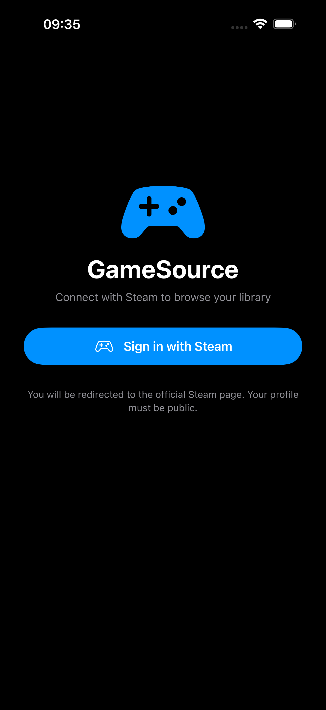
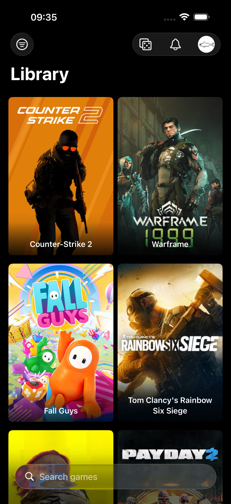
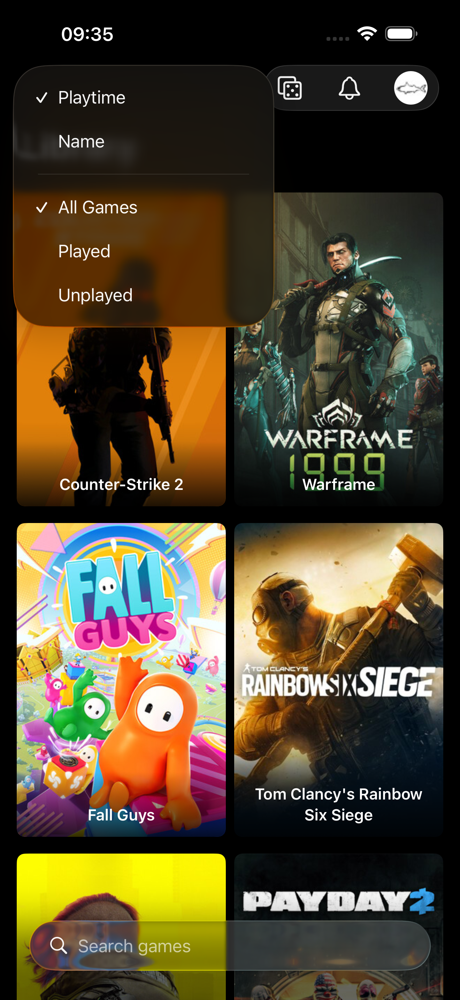
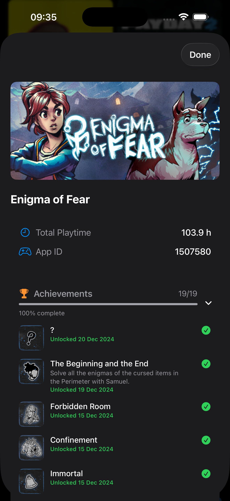
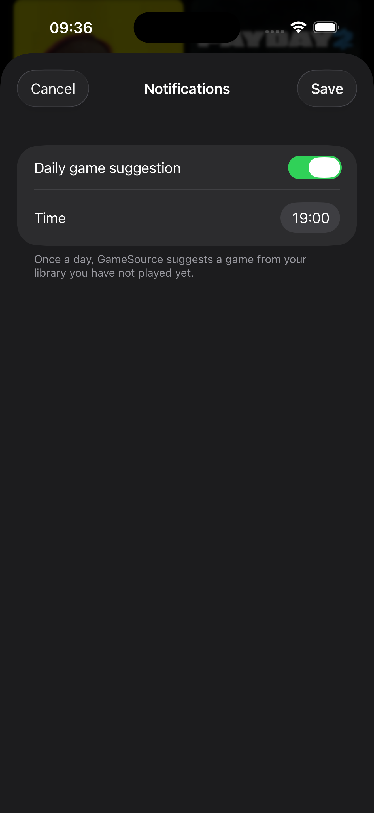

# GameSource

[](https://developer.apple.com/ios/)
[](https://swift.org)
[](https://developer.apple.com/xcode/swiftui/)
[](#architecture)

iOS app written entirely in SwiftUI that consumes the [Steam Web API](https://steamcommunity.com/dev). After signing in with a real Steam account, the app shows the user's game library as a cover grid with search, sorting and filters. Tapping a game opens a detail sheet with playtime, the full achievement list with icons and progress, and a link to the Steam Store. It is a simplified rewrite of my original [GameSource](https://github.com/EnzoFerroni/GameSource), rebuilt with less code and a cleaner structure.

## Screenshots

| Login | Library | Filters | Detail | Notifications |
| --- | --- | --- | --- | --- |
|  |  |  |  |  |

## Features

- Sign in with Steam through the real OpenID login, persisted across launches
- Library as a cover grid, with the user's avatar in the toolbar
- Search, sort (playtime or name) and filter (all, played, unplayed)
- Detail sheet with playtime, achievements (icons, unlock dates, completion bar) and a store link
- Random game picker
- Daily notification suggesting a game never played
- Loading, error and empty states, with pull to refresh and retry

## Requirements

- Xcode 26 or later
- iOS 26 or later
- A Steam account with a public profile
- A free [Steam Web API key](https://steamcommunity.com/dev/apikey)

## Getting Started

**1. Clone the repository**

```bash
git clone https://github.com/EnzoFerroni/GameSource-Case.git
cd GameSource-Case
```

**2. Add your Steam API key**

The key is kept out of version control. Create `GameSource/Secrets.xcconfig` with your own key:

```
STEAM_API_KEY = your_key_here
```

**3. Run**

Open `GameSource.xcodeproj`, select an iOS Simulator and press Run. No package resolution or extra setup is needed.

**4. Sign in**

Tap "Sign in with Steam" and log in with your account. Your profile and game details must be public for the API to return data.

## Architecture

The app follows **MVVM**. Views only describe the UI and forward user actions. Each screen has its own view model holding all state and logic, and every network call lives in a dedicated service layer.

```
GameSource/
├── App/             GameSourceApp (entry point), StorageKey
├── Models/          SteamGame, SteamAchievement, SteamUserProfile, FilterOptions
├── Services/        SteamService, NotificationService, Secrets
├── ViewModels/      AuthViewModel, GameLibraryViewModel, GameDetailViewModel
└── Views/           LoginView, GameLibraryView, GameCardView, GameDetailView,
                     NotificationSettingsView
GameSourceTests/     FakeGameService, GameLibraryViewModelTests,
                     GameDetailViewModelTests
docs/                Static page that completes the Steam login (GitHub Pages)
```

Views observe the view model through `@Published` properties, so the UI updates itself whenever state changes. No third-party frameworks are used.

## Technical Decisions

**Real Steam login with `ASWebAuthenticationSession`**

Steam has no "Sign in with Steam" SDK, only OpenID 2.0, and it only redirects back to http(s) addresses. The login opens Steam's official page in an `ASWebAuthenticationSession`; after login, Steam redirects to a small static page served by this repository's GitHub Pages (`docs/index.html`), which forwards the response into the app through the `loginsteam://` custom scheme. The session intercepts that scheme directly, so it does not need to be registered in the Info.plist. The SteamID is then read from the `openid.claimed_id` field.

**MVVM with `ObservableObject`**

Each view model is a `final class` marked `@MainActor`, so every state update is guaranteed to happen on the main thread, which SwiftUI requires. Screen state uses `@Published private(set)`, so views can read it but only the view model can change it.

**The service behind a protocol**

View models receive the service through the small `GameFetching` protocol with a default of `SteamService()`. Production code never changes, but tests inject a `FakeGameService` and run without touching the network.

**`async/await` with parallel requests**

All requests use `URLSession` with `async/await`. When two independent calls are needed (games and profile, or achievement progress and icons), `async let` starts both at the same time, so the screen waits only for the slower one.

**Achievements merged with a dictionary**

The achievement list comes from one endpoint and the icons from another. The two responses are joined through a dictionary keyed by achievement name, so finding each icon is instant instead of searching the whole list once per achievement.

**Session with `@AppStorage`**

The SteamID is saved in `UserDefaults` and read with `@AppStorage` at the app root. Login stores it, logout clears it, and SwiftUI swaps between the login screen and the library automatically. All storage keys live in one `StorageKey` enum, so a typo cannot split one value into two keys.

**API key via `Secrets.xcconfig`**

The Steam key is injected at build time through a gitignored `.xcconfig` file. At runtime, `Secrets.swift` reads it from `Bundle.main.infoDictionary`, keeping the key out of version control.

**`LazyVGrid` and `AsyncImage`**

The grid only builds the cards about to appear on screen, which keeps scrolling smooth on large libraries. Covers are downloaded by `AsyncImage`, with a placeholder that keeps the card size stable while the image loads or if it fails.

**Loading, error and empty states**

The library shows a spinner while loading, a retry button on failure and `ContentUnavailableView` when the library or a search comes back empty. A failure loading achievements only shows the section as empty, so the detail screen stays usable.

**Daily suggestion with local notifications**

`UNCalendarNotificationTrigger` repeats every day at the chosen time, suggesting a game never played. Scheduling always uses the same identifier, so saving again replaces the previous notification instead of stacking new ones.

**Accessibility**

Each game card reads as a single VoiceOver item with the game name, icon-only toolbar buttons have spoken labels, decorative images are hidden, and text uses scalable styles so it follows the size chosen in Settings (Dynamic Type).

**Unit tests with a fake service**

The view models are tested with Swift Testing and the injected `FakeGameService`: loading, error messages, search, filters, sorting, the achievement icon merge and the completion percentage. Run with **Cmd+U**.

**Left out on purpose**

No image cache beyond what `AsyncImage` provides, no offline persistence and no third-party libraries. The goal is the smallest codebase that still covers the full flow: real login, REST consumption, MVVM and tests.
